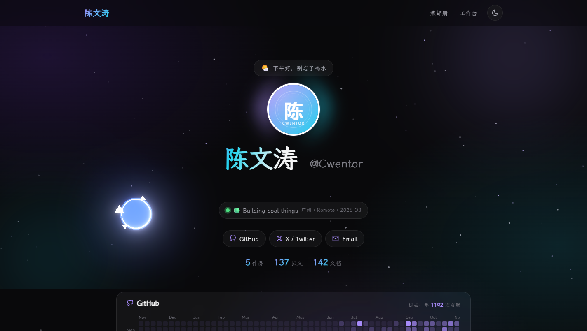

# Manus · 个人主页展厅

一个「内容与 UI 彻底分离」的静态个人主页：Markdown 驱动、零打包工具（纯 Node.js 预构建），带工作台、文章整页、暗色星空等特性。

 

## ✨ 特性

- **内容与 UI 分离**：所有内容来自 `content/` 下的 Markdown / JSON，Front-matter 即数据契约，构建脚本渲染为原生 HTML
- **零打包工具**：无 Webpack / Vite，`build.js` 一个文件完成构建（shiki 构建期语法高亮，0 运行时开销）
- **双页架构**：主页展示个人形象；工作台（Workspace）是仿文档站的三栏阅读器——左侧分类文档树（每个文件夹首位是自动生成的「Wiki 导览」，列出本目录全部子目录与文章；文件夹可折叠、计数、状态持久化）、中间当前文档阅读区（面包屑可点击跳转到对应文件夹导览 + 标签 + 上一篇/下一篇）、右侧本文目录（TOC 滚动跟随高亮），支持 `Ctrl+K` 全文查找（Zensical 风格结果面板：结果计数 + 分类/日期面包屑 + 标题与正文摘要关键词高亮，`↑↓` 选择、回车打开），`#/slug` hash 路由可直接分享定位
- **文章整页**：每篇长文 / 产品 / 导览构建为独立静态页（`/articles/<slug>.html`），可分享、可收藏，也是工作台阅读器的按需取用数据源
- **沉浸式动效**：入场开屏、暗色流体极光 + 动态星空（闪烁 / 视差 / 流星）、头像 3D 翻转、卡片光斑跟随、滚动进度条
- **主页两段交互彩蛋**：鼠标轨迹画廊（光标扫过生成作品卡、2.5 秒后消散）与照片卡堆
  （抓起甩出、按松手速度滑行回正、双击全部归位）。图源直接复用作品封面 SVG，不额外维护图片清单；
  样式独立在 `public/css/effects.css`（`.fx-` 前缀），只在主页引入，不干扰其余页面
- **博客迁移设计**（沿用旧博客 Zensical-CatDrink-Blog 的版式设计，按本站风格适配，无 Zensical 依赖）：
  霞鹜文楷字体、时段问候语条、多句循环打字机、GitHub 贡献热力图、Hero 交互网格 Canvas、
  代码块复制按钮、标签页切换彩蛋、页脚一言、菱形分隔线 / 渐变引用等文章排版
- **阅读体验**：主页抽屉秒开（内容池 `<template>` 预载）、亮 / 暗双主题、响应式、`prefers-reduced-motion` 无障碍降级
- **开源集邮册**（`/stamps/index.html`，独立页面）：把收藏的开源项目做成纪念邮票墙——纯 CSS 齿孔票、
  票名 / 面值（★ 数）/ 票种、四种可切换邮戳（localStorage 持久化）、归档仓库盖「注销」封存章、
  搜索 / 票种筛选 / 三种排序、末行「待收集」空位池化补齐。视觉与主页 / 工作台统一（同一套设计令牌、
  玻璃导航、亮暗主题共用 `showcase-theme`）；齿孔、邮戳、橡皮章这些集邮册自己的语言保留，只把
  「米黄纸张 + 砖红墨」换成「卡面 + 强调色」——票纸在亮色下必须比页面底稍深，否则齿孔的半圆缺口
  与背景同色，整张票会退化成直角卡片

- **点击特效**（`public/js/click-fx.js` + `public/js/vendor/ba-click-fx.slim.js`，源自 [ba-click-fx](https://github.com/CialloKing/ba-click-fx)，MIT，详见文末「致谢」）：
  主页 / 工作台 / 文章页生效，蔚蓝档案风格点击爆闪与光标拖尾。202 KB 的 vendor 模块懒加载
  （load 后空闲预热或首次指针交互才拉取，不进首屏关键路径）。暗色用库默认的 `screen` 加亮混合，
  浅色底没有增亮空间，由 `components.css` 用 `mix-blend-mode: multiply` 覆盖（白底 × 蓝光 = 蓝，
  光弧保色），跟随 `<html data-theme>` 自动切换。触屏与 `prefers-reduced-motion` 直接跳过，
  标签页隐藏自动暂停

## 🚀 快速开始

```bash
# 环境要求：Node.js >= 18
npm install     # 安装依赖
npm run build   # 构建到 dist/
npm run dev     # 构建 + 本地预览（http://localhost:4173）
npm run serve   # 仅启动本地预览
```

## 📁 目录结构

```
ManusNote/
├── build.js              # 核心预构建脚本（读取内容 → 渲染 → 装配页面）
├── scripts/
│   └── serve.js          # 零依赖静态服务器（本地预览）
├── content/              # ✏️ 所有内容都在这里（改这里就够了）
│   ├── profile.json      # 个人信息 / 社交链接 / 打字机短语 / GitHub 用户名
│   ├── products/*.md     # 产品卡片（Front-matter: title/tagline/cover/status/tech_stack/order…）
│   └── blog/             # 全部文档（递归扫描，一级子目录即工作台分类）
│       ├── *.md          # 长文（Front-matter: title/date/summary/tags/read_time + 可选 slug/category/featured）
│       ├── job/          # 求职
│       ├── knowledge/    # 知识库
│       │   └── 教资备考/ # 小学教资笔记 46 篇（scripts/import-teacher-notes.js 从本地笔记迁移）
│       ├── draft/        # ✍️ 草稿区（不参与构建，仅提交到仓库；移出即发布）
│       ├── podcast/      # 播客
│       ├── relax/        # 闲聊
│       ├── web/          # 资源分享
│       ├── skills/       # 技能
│       ├── about/        # 关于
│       └── …非 .md 附件  # 图片 / 音频 / PDF 等，构建时复制到 dist/blog/<相对路径>
├── templates/            # 页面骨架（index / workspace / article / 卡片模板）
├── public/               # 静态资源（css / js / 图片），构建时原样复制
│   └── stamps/           # 开源集邮册独立页（index.html + css + js 模块 + data/*.json）
├── scripts/              # serve.js 本地预览 · normalize-blog.js 知识库迁移整理 · import-teacher-notes.js 教资笔记导入
├── tools/stamp-album/    # 集邮册数据工具：parse-repos.mjs 由 links.txt 生成 collection.json
├── tests/stamps/         # 集邮册模块契约测试（node --test，npm run test:stamps）
├── docs/                 # README 用图（点击特效效果图等），不参与构建
└── dist/                 # 构建产物（git 忽略，部署它即可）
```

## ✍️ 写一篇新文章

在 `content/blog/`（或任意分类子目录，如 `content/blog/knowledge/`）新建 `my-post.md`：

```markdown
---
title: "文章标题"
date: "2026-09-06"
summary: "一句话摘要"
tags: ["Tag1", "Tag2"]
read_time: "5 min"
# 可选字段：
# slug: "my-post"       # 自定义 URL（缺省用文件名，重名自动用目录路径派生）
# category: "knowledge" # 工作台分类（缺省取一级目录名，根目录为 blog/长文）
# featured: true        # 出现在主页「精选长文」与首页内容池（缺省只进工作台归档）
---

正文支持完整 Markdown，代码块构建期高亮，允许原始 HTML（图片 / 音频 / 表格等）。
正文里的相对引用附件请放在同目录下，构建时会改写为 /blog/... 绝对路径；
也可直接使用 /blog/<相对路径> 绝对引用。
```

重新 `npm run build` 后：工作台文档归档、`/articles/<slug>.html` 整页会自动生成；标记 `featured: true` 的文章还会出现在主页「精选长文」。

> **草稿模式**：把还没想好要不要发布的文档放进 `content/blog/draft/`（可继续用子目录分组）。
> 构建时会整棵子树跳过——不生成 `/articles/<slug>.html`、不进主页内容池、不进工作台文档树与搜索索引，
> 目录里的图片 / PDF 等附件也不会复制到 `dist/`；但文件本身照常提交到 Git 仓库。
> 想发布时把文件移出 `draft/` 即可，无需改动 Front-matter。

> 知识库批量迁移可用 `node scripts/normalize-blog.js`：自动为旧文档补齐规范 Front-matter（只动元数据，正文逐字节校验零改动），原始 front-matter 备份在 `scripts/normalize-blog.backup.json`。

## 📦 依赖

运行时零依赖；构建期依赖（`package.json`）：

| 依赖 | 用途 |
|------|------|
| [gray-matter](https://github.com/jonschlinkert/gray-matter) | 解析 Markdown Front-matter 元数据 |
| [markdown-it](https://github.com/markdown-it/markdown-it) | Markdown → HTML 渲染（`html:false` 安全加固） |
| [shiki](https://github.com/shikijs/shiki) | 构建期代码语法高亮（vitesse-dark 主题） |

## 🌐 部署

`dist/` 是纯静态目录，任意静态托管皆可：GitHub Pages、Vercel、Netlify、Cloudflare Pages、Nginx。构建命令 `npm run build`，产物目录 `dist`。

### GitHub Pages 自动化部署（推荐）

本项目已配置 GitHub Actions，推送到 `master` 分支即可自动构建并部署到 GitHub Pages。

**首次部署步骤（关键！）：**

1. **进入 Settings → Pages → Build and deployment**
   - **Source** 选择 **`GitHub Actions`**（⚠️ 必须选这个，不要选 "Deploy from a branch"）

2. **推送代码触发部署**
   ```bash
   git add .
   git commit -m "feat: enable GitHub Pages deploy"
   git push origin master
   ```

3. **查看 CI 状态**
   - 进入 **Actions** 标签页，确认 `Deploy to GitHub Pages` workflow 成功运行
   - 部署完成后站点地址为：`https://Cwentor.github.io/Manus/`

> **⚠️ 如果报错 `Liquid syntax error`：**
> 说明 GitHub Pages 仍在走默认的 Jekyll 构建（`jekyll-build-pages@v1`）。
> 请务必在 **Settings → Pages → Source** 中选择 **`GitHub Actions`**，而非 "Deploy from a branch"。
> 本仓库已添加 `.nojekyll` 和 `_config.yml` 作为额外防护，但**根本解决方式是切换 Source**。

**工作流文件：** `.github/workflows/deploy.yml`

**手动触发部署：**
- 在 **Actions** 页面找到 `Deploy to GitHub Pages`，点击 **Run workflow** → **Run workflow** 按钮

### 手动部署（不推荐）

若需手动部署到 GitHub Pages：

```bash
npm run build                  # 构建到 dist/
git add dist/
git commit -m "deploy: update dist"
git push origin master
```

然后在 GitHub 仓库的 **Settings → Pages** 中将 **Source** 改为 `Deploy from a branch`，分支选择 `master`，目录选择 `/ (root)`。

## 🙏 致谢

站点的观感不是从零长出来的，其中相当一部分来自开源社区。

### 点击特效：ba-click-fx

- 仓库：[CialloKing/ba-click-fx](https://github.com/CialloKing/ba-click-fx)（作者 CialloKing）
- 在线演示：[ba-click-fx.cialloking.top](https://ba-click-fx.cialloking.top)
- 许可：MIT，原始许可文本与版权声明见 `public/js/vendor/LICENSE-ba-click-fx.txt`
- 本项目使用官方 **v1.3.15 精简版** `ba-click-fx.slim-webgl2-128.js`（WebGL2 + 128² DOM，主 JS 约 192 KiB），本地存放为 `public/js/vendor/ba-click-fx.slim.js`，**库代码未作任何修改**

页面效果（暗色主题，点击页面空白处）：



浅色主题同样生效：库内部固定 `screen`（加亮）混合，白底没有增亮空间，因此由本站 `components.css` 按 `<html data-theme>` 改为 `multiply` 加饱和压亮度（白底 × 蓝光 = 蓝，光弧保色），效果比暗色含蓄。

库之外的一层薄封装 `public/js/click-fx.js` 是本项目自己写的，负责四件事：

| 行为 | 说明 |
|------|------|
| 懒加载 | 首次指针交互立即拉取，或在 `load` 后空闲时预热；202 KB 不进首屏关键路径 |
| 门控 | `prefers-reduced-motion`、触屏（`pointer: coarse`）、无 WebGL2 时直接不加载；系统运行中开启「减少动效」会销毁实例 |
| 主题适配 | 混合方式交给 CSS（`:has()` 命中覆盖层），老浏览器由 JS 打内联 `!important` 兜底 |
| 省电 | 标签页隐藏时 `setPaused(true)`，回来恢复，不空转 GPU |

### 排版与灵感

- 旧博客 Zensical-CatDrink-Blog（作者 [@Cwentor](https://github.com/Cwentor)）：工作台的文档树 / 搜索面板与文章排版（霞鹜文楷、时段问候、打字机、GitHub 贡献热力图、代码复制按钮、页脚一言等）沿用其版式设计，按本站风格重写，不引入 [Zensical](https://zensical.org) 运行时依赖。
- 构建期依赖：[gray-matter](https://github.com/jonschlinkert/gray-matter)、[markdown-it](https://github.com/markdown-it/markdown-it)、[shiki](https://github.com/shikijs/shiki)。

## License

MIT
