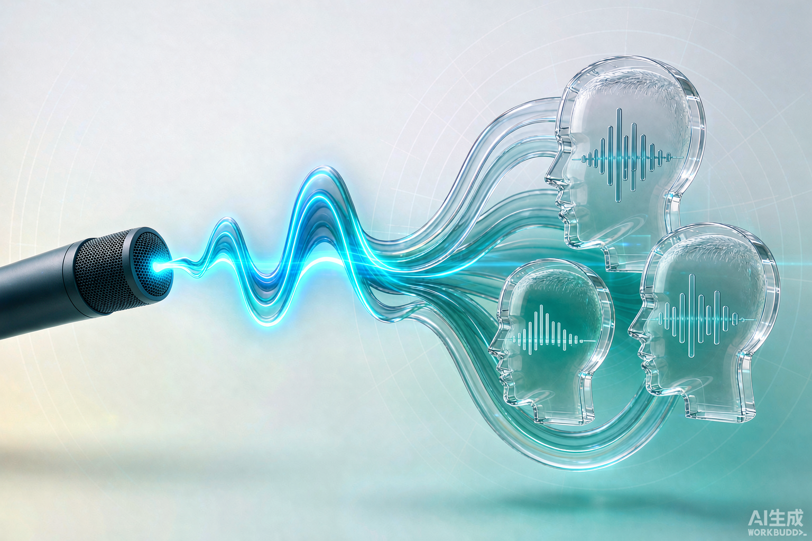
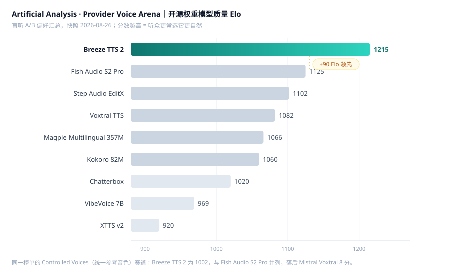
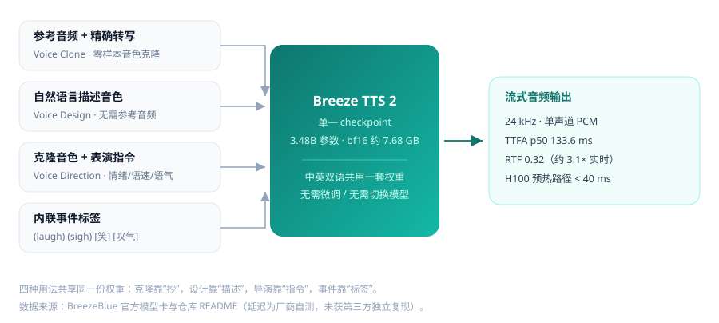
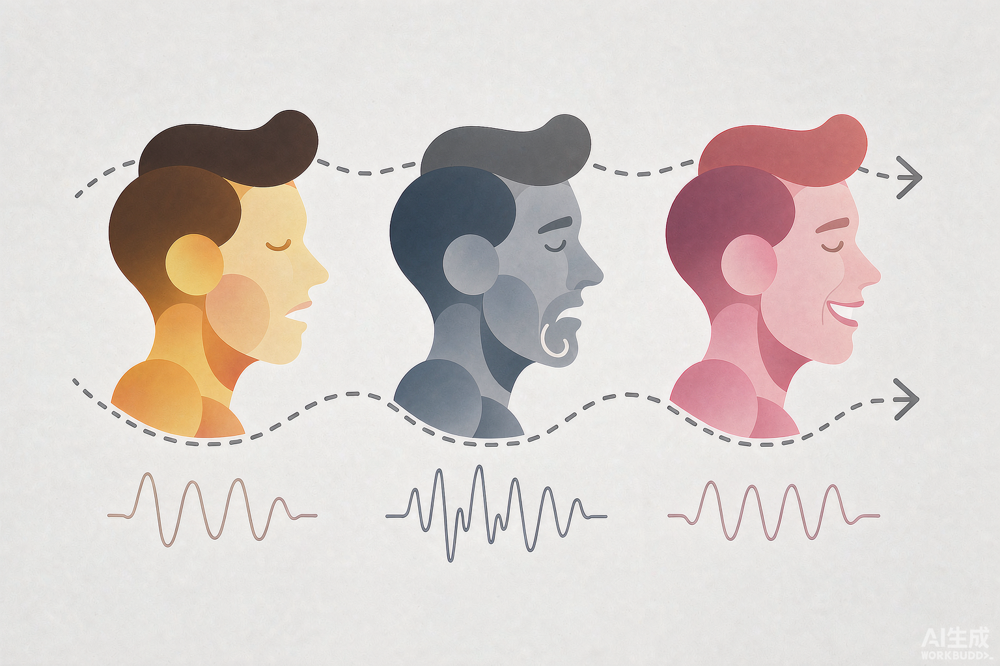
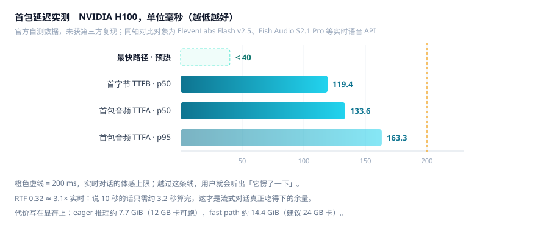

> **一句话结论**：3.48B 参数、中英双语、7.7 GiB 显存就能跑、首包音频中位数 133 ms——它在盲听榜上确实是开源权重里的第一名，但**权重是「非商用」许可**，想拿它做付费产品必须另外谈授权。这是整篇最容易被忽略的一条。

Breeze TTS 2（模型 ID `BreezeBlue/Breeze-TTS-2`）由 BreezeBlue（母公司 RESONIA, INC.）于 **2026-08-25** 开源权重与 PyTorch 推理代码，主打**角色语音设计、零样本克隆、自然语言表演控制**，面向实时语音对话、有声书、AI 配音、游戏角色语音。

---

## 0. TL;DR

| 维度 | 结论 |
| --- | --- |
| 参数量 / 体积 | 3.48B（bf16 约 7.68 GB） |
| 语言 | 开源权重：中 + 英；官方托管 API 另有 `breeze-tts-2-multilingual`（50+ 语种） |
| 榜单 | Artificial Analysis Provider Voices **开源权重第 1**（Elo 1215，领先第二名 90 分），全榜约第 6 |
| 延迟 | TTFB p50 119.4 ms / TTFA p50 133.6 ms / p95 163.3 ms；H100 预热 fast path **< 40 ms** |
| 吞吐 | RTF 0.32，约 3.1× 实时 |
| 硬件 | eager 约 7.7 GiB（12 GB 卡）；fast path 约 14.4 GiB（建议 24 GB 卡） |
| 许可 | 代码 Apache 2.0；**权重仅研究与非商用**，商用需单独授权 |
| 最适合 | 实时语音 Agent、角色配音 Demo、有声书原型、私有化验证 |

---

## 1. 榜单到底赢在哪、没赢在哪

这是最值得较真的部分。Artificial Analysis 的 TTS 榜有两条赛道，Breeze TTS 2 在两条上的位置完全不同：



**赛道一：Provider Voices（各用自家原生音色）**

| 排名 | 模型 | 机构 | Elo |
| --- | --- | --- | --- |
| 1 | **Breeze TTS 2** | BreezeBlue | **1215** |
| 2 | Fish Audio S2 Pro | Fish Audio | 1125 |
| 3 | Step Audio EditX（2026-03） | StepFun | 1102 |
| 4 | Voxtral TTS | Mistral | 1082 |
| 5 | Magpie-Multilingual 357M | NVIDIA | 1066 |
| 6 | Kokoro 82M | Kokoro | 1060 |
| 7 | Chatterbox | Resemble AI | 1020 |
| 8 | VibeVoice 7B | Microsoft | 969 |
| 9 | XTTS v2 | Coqui | 920 |

**赛道二：Controlled Voices（所有模型克隆同一个参考说话人）**

| 指标 | Breeze TTS 2 |
| --- | --- |
| Elo | 1002 |
| 开源权重排名 | 第 3（与 Fish Audio S2 Pro 并列） |
| 落后榜首 | 8 分（Mistral Voxtral TTS 1010） |
| 全榜排名 | 第 16 / 39 |

**这两张榜的落差说明了一件事**：Breeze TTS 2 的分数很大一部分来自「它自己设计出来的音色本身好听」，而不是「它的声学合成更自然」。一旦把音色变量按住、所有模型克隆同一个声音，它的优势就收敛到和 Fish Audio 同一水平。所以：

- 你要**从零造一个角色音色** → 它确实是当前开源里的最优解；
- 你要**复刻一个已有的真实音色** → 它只是第一梯队，不是碾压级。

再看总榜（含闭源 API）：Cartesia Sonic 3.6（约 1283）、Qwen-Audio-3.0-TTS-Plus / Simba 3.2（1238）、Luna TTS（1223）、Eleven v3 Conversational（1219）在其之上，Breeze TTS 2 的 1215 落在第 6 附近——和 Eleven v3 Conversational 只差 4 分，属于「统计上打平」。

> ⚠️ 三个注意：Elo 会随投票持续漂移，个位数差距应视为并列；BreezeBlue 自己还额外开源了三套评测集（Voice Design / Voice Direction / Latency）并自评第一，这些**不是独立第三方评测**；延迟数值同样只有厂商单一来源。

---

## 2. 四项核心能力：一份权重，四种用法



### 2.1 Voice Clone（零样本音色克隆）

一段干净参考音频 + **它的准确转写文本** → 复刻音色、节奏、情绪风格，不需要微调训练。

```bash
python infer.py ../breeze-tts-2 \
  --ref-audio reference_zh.wav \
  --ref-text "这是中文参考音频的准确文字稿。" \
  --text "[叹气] 没想到过了这么久，你还记得我的声音。" \
  --output outputs/voice_clone_zh.wav
```

**这里的坑**：`--ref-text` 不是可选项。只给音频不给转写，效果会明显掉档——模型需要靠转写把音频对齐到文本空间。参考音频还要求干净、低噪、单人。

### 2.2 Voice Design（语音设计）

**不需要任何参考音频**，直接用自然语言描述生成全新音色：温柔少年、沙哑大叔、慵懒御姐都行。

```bash
python infer.py ../breeze-tts-2 \
  --text "[笑] 欢迎来到今晚的故事时间，让我们一起开始吧。" \
  --instruction "A warm, thoughtful young woman with a clear voice and a calm, reflective delivery." \
  --cfg-scale 4 \
  --output outputs/voice_design_zh.wav
```

三条实操经验：
- **描述语言要跟目标文本语言一致**（生成中文就用中文描述），否则指令跟随会变差；
- `--cfg-scale 4` 会显著加强指令遵循度，代价是音色自然度略有波动；
- 纯提示词生成音色的**稳定性不如参考克隆**——同一个描述跑多次，音色会有偏移。要固定角色，第一次生成满意的音频后存下来当参考音频用，转成克隆路线。

### 2.3 Voice Direction（表演控制）

先克隆一个音色，再用自然语言逐句控制语气、语速、情绪，**音色身份不变**。这是它区别于「一次性朗读」TTS 的关键：同一个角色可以在同一段脚本里激动、委屈、冷笑。



| 控制维度 | 写法示例 |
| --- | --- |
| 情绪 | 「压着怒气，几乎是从牙缝里挤出来的」 |
| 语速 | 「放慢，每个字之间留半拍停顿」 |
| 音量/气息 | 「气声，像在耳边低语」 |
| 表演风格 | 「纪录片旁白，克制、不带感情」 |

官方自评的 Voice Direction 得分 4.25（次名 MiMo-v2.5-TTS 3.76），同时把说话人相似度（SPK_SIM）保持在 0.67——**这两个指标天然对立**：表演幅度越大越容易跑音色。0.67 属于「听得出来是同一人，但有轻微漂移」，不是完美锁死。

### 2.4 Vocal Events（内置副语言标记）

脚本里直接写事件标签，模型会把它渲染成真实的声音事件，而不是把标签念出来。

| 语言 | 写法 |
| --- | --- |
| 英文 | 圆括号：`(laugh)` `(sigh)` `(cough)` `(clears throat)` |
| 中文 | **方括号**：`[笑]` `[叹气]` `[咳嗽]` `[清嗓子]` |

**这是最容易写错的地方**：中文用方括号不用圆括号。写成 `(笑)` 大概率会被当普通文本念出来或直接忽略。

---

## 3. 延迟与硬件：数字要看清楚是哪个数



| 指标 | 数值 | 说明 |
| --- | --- | --- |
| TTFB p50 | 119.4 ms | 首字节 |
| TTFA p50 | 133.6 ms | 首包音频（中位） |
| TTFA p95 | 163.3 ms | 尾部延迟 |
| 最快路径 | **< 40 ms** | 仅限 H100 + 预热后的 fast path |
| RTF | 0.32 | 约 3.1× 实时 |
| 输出格式 | 24 kHz / 单声道 PCM | 实时语音栈的标准输入格式 |

**别把 `< 40 ms` 当成常态**。40 ms 是 H100 数据中心卡、模型已预热、走 fast path 的最佳值；中位数 133.6 ms 才是你实际要按着做预算的数。这两个数字被很多二手文章混着写，你按 133 ms 设计你的 VAD 和打断逻辑才不会翻车。

显存要求：

| 模式 | 显存 | 建议卡 |
| --- | --- | --- |
| eager 推理 | ≈ 7.7 GiB | 12 GB（RTX 4070 / 3060 12G 级别） |
| `--fast-all` | ≈ 14.4 GiB | 24 GB（4090 / A10 / L4 级别） |

运行环境硬门槛：**Linux + Python ≥ 3.10 + NVIDIA CUDA**。官方 Docker 默认目标 sm90（H100/Hopper），A100 需要 `FLASH_ATTN_CUDA_ARCHS=80 bash docker/build.sh` 重新构建。想在 Mac 上原生跑，目前没有官方路径。

---

## 4. 上手路径

**交付物清单**

| 资源 | 地址 | 许可 |
| --- | --- | --- |
| 推理代码（官方仓库） | `github.com/breezeblue-ai/breeze-tts` | Apache 2.0 |
| 权重 | `huggingface.co/BreezeBlue/breeze-tts-2`、魔搭 `BreezeBlue/Breeze-TTS-2` | 研究 / 非商用 |
| 评测集 | `breezeblue-ai/TTS-Voice-Design-Benchmark`、`TTS-Voice-Direction-Benchmark`、`TTS-Latency-Benchmark` | 开源 |
| 在线体验 | BreezeBlue 官方平台 BreezeCreator | 商业条款 |
| 托管 API | `breeze-tts-2` / 多语种 `breeze-tts-2-multilingual`，约 $34 / 百万字符 | 商业条款 |

**仓库里到底有什么**

官方仓库是纯推理实现，**不含权重**（权重在 HuggingFace / 魔搭，需另下）。目录结构大致是：

| 路径 | 用途 |
| --- | --- |
| `infer.py` | CLI 入口，克隆 / 设计 / 导演三种模式都走它 |
| `breeze_infer/` | 推理核心：文本编码器、backbone、depth decoder、codec、流式服务 |
| `configs/` | 模型与推理配置 |
| `docker/` | 官方 Docker 构建脚本（默认 sm90，A100 需改 `FLASH_ATTN_CUDA_ARCHS`） |
| `models/` | 模型定义 |
| `tests/` | 测试集（提交记录里反复提到「102 tests」） |
| `LICENSE` | 注意：这是**代码**许可，不是权重许可 |

仓库维护是活的，不是发完就躺平：8 月 25 日首发，9 月起陆续补 voice-direction 覆盖、离线批量合成接口、Hugging Face checkpoint 解析，10 月 13 日还在合并 CUDA Graph 批量化解码的性能 PR。这一点对长期依赖挺重要。

**三条命令跑通**

```bash
git clone https://github.com/breezeblue-ai/breeze-tts.git
cd breeze-tts
python -m pip install -r requirements.txt
bash docker/build.sh            # 默认 H100/Hopper；A100 加 FLASH_ATTN_CUDA_ARCHS=80
```

**实时对话接入**（官方 SDK 走单条 WebSocket 长连接跨轮复用，边生成边回流 PCM，示意）：

```ts
const connection = await client.textToSpeech.realtime.connect("voc_...", {
  modelId: "breeze-tts-2",
});
connection.startTurn("turn_1");
connection.appendText("Hello from Breeze TTS 2.");
connection.flush();
connection.endTurn();
```

**生态现状，别听二手总结**

官方只交付 PyTorch + Docker + CLI/HTTP 服务。但周边已经长出来了，可以按靠谱程度排序用：

| 生态 | 状态 | 说明 |
| --- | --- | --- |
| `mlx-community/Breeze-TTS-2-mlx` | ✅ 可用 | MLX bf16，约 7.6 GB，可在 Apple Silicon 上跑 |
| `mlx-community/Breeze-TTS-2-mlx-8bit` / `-4bit` | ✅ 可用 | 约 4.6 GB / 3.0 GB，`-4bit` 还有第三方副本 `LunaFox/Breeze-TTS-2-mlx-4bit` |
| `mlx-audio` | ✅ 已内置 | 模型注册名 `breeze` / `breeze-tts`，`mlx_audio.tts.load` 直接加载 |
| ComfyUI 节点 | ⚠️ 自行验证 | 非官方，节点维护状况波动大，上项目前看提交时间 |
| Gradio 示例 | ⚠️ 自行验证 | 官方仓库未随代码提供稳定 UI 示例 |

**一个必踩的坑**：上游 PyTorch 的 safetensors **不能**直接被 MLX 加载，必须用社区转好的 MLX 版本。好消息是原始 checkpoint 里已经捆了文本编码器与音频 codec 权重，MLX 推理不需要上游 PyTorch 运行时。另外 MLX 版本的许可同样沿用「研究 / 非商用」，别以为换个格式就换了授权。

---

## 5. 许可证：这才是真正的决策点

「开源权重」不等于「开源软件」，这里被切成了两块：

| 对象 | 许可 | 你能做什么 |
| --- | --- | --- |
| 推理代码 | Apache 2.0 | 商用、修改、再分发，随便 |
| 模型权重 / 衍生模型 / 自托管产出 | BreezeBlue Research and Non-Commercial License | **只限研究与非商用** |
| BreezeBlue 托管平台的产出 | 需有效付费订阅 | 可商用，但**不**因此获得权重商用权 |

**没有小规模豁免，没有营收门槛**。判断标准是「是否处于商业语境」：

- 免费 App 生成语音、靠广告变现 → **算商用**；
- 公司内部工具给客服念工单 → 服务于营利业务，**也算商用**，别自己脑补成内部使用就没事；
- 高校评测、论文复现 → 没问题。

一句话：**要商用，找 RESONIA 谈授权，不要拿权重直接上线。**

---

## 6. 限制清单

| 限制 | 影响 | 缓解 |
| --- | --- | --- |
| 克隆必须配准确转写 | 只有音频效果明显下降 | 用 ASR 先转写再人工校对 |
| 权重仅中英双语 | 多语种项目直接出局 | 用托管 API 的多语种版，或换模型 |
| 纯提示词音色稳定性一般 | 同描述多次生成有漂移 | 定稿后转参考音频克隆 |
| 表演控制会跑音色（SPK_SIM 0.67） | 大情绪段落音色轻微漂移 | 极端表演拆短句重新生成 |
| 官方仅 Linux + CUDA | Mac / Windows 原生不可用 | Mac 走社区 MLX 版，Windows 用 WSL2 / Docker |
| 榜单与延迟均为厂商自测 | 真实体验可能低于宣传 | 自己拿 20 条业务文案做盲测再定 |
| 中文事件标签易写错 | 事件不触发 | 中文一律方括号 |

---

## 7. 什么时候用它，什么时候别用

| 你的场景 | 建议 |
| --- | --- |
| 实时语音 Agent（中英双语） | ✅ 强推荐，延迟与表演控制都在第一梯队 |
| 游戏 / 动画角色配音 | ✅ 强推荐，Voice Design + Direction 是核心卖点 |
| 有声书、播客原型 | ✅ 推荐，先跑 Demo 验证听感 |
| 私有化部署验证 | ✅ 推荐，12 GB 卡就能起步 |
| 中文以外的多语种商用 | ❌ 权重不行，走 API 或换模型 |
| 直接商业化上线 | ❌ 除非拿到书面商用授权 |
| 复刻真人（无授权） | ❌ 法律与伦理风险，别碰 |

---

## 8. 一句话收尾

Breeze TTS 2 真正的价值不在于那 90 分 Elo，而在于它把「**设计音色 + 导演表演 + 流式低延迟**」三件事塞进了同一份 3.48B 权重里，且 12 GB 消费级卡就能跑。这是过去只能靠商业 API 拼装的能力组合。

但它的许可证写法也很坦白：给你研究，不给你做生意。评估可以立刻开始，商业化先准备预算。

---

## 附录

**术语表**

| 术语 | 含义 |
| --- | --- |
| TTFA | Time To First Audio，从发起请求到收到第一段可播放音频 |
| TTFB | Time To First Byte，首字节时间 |
| RTF | Real-Time Factor，生成耗时 / 音频时长，越小越快 |
| SPK_SIM | Speaker Similarity，说话人相似度，衡量音色是否漂移 |
| Zero-shot | 零样本，不给训练样本直接泛化到新音色 |

**参考来源**

1. BreezeBlue 官方模型卡（ModelScope / Hugging Face）— 参数、延迟、许可、CLI 用法
2. BreezeBlue 官方博客《Breeze TTS 2 Is #1 on the Artificial Analysis Open-Weights TTS Leaderboard》— 榜单单曲与快照口径
3. Artificial Analysis TTS Arena — Provider Voices / Controlled Voices 双赛道 Elo
4. 第三方模型卡整理（参数结构、价格、竞品横评）— 标注为第三方拆解，与官方口径存在出入处已在正文注明
5. 独立评测对比文章 — 许可证边界与 ElevenLabs 横向对比

> 本文数据核对时间：2026-10-30。Elo 与榜单排名会持续变动，引用前请回源确认。
